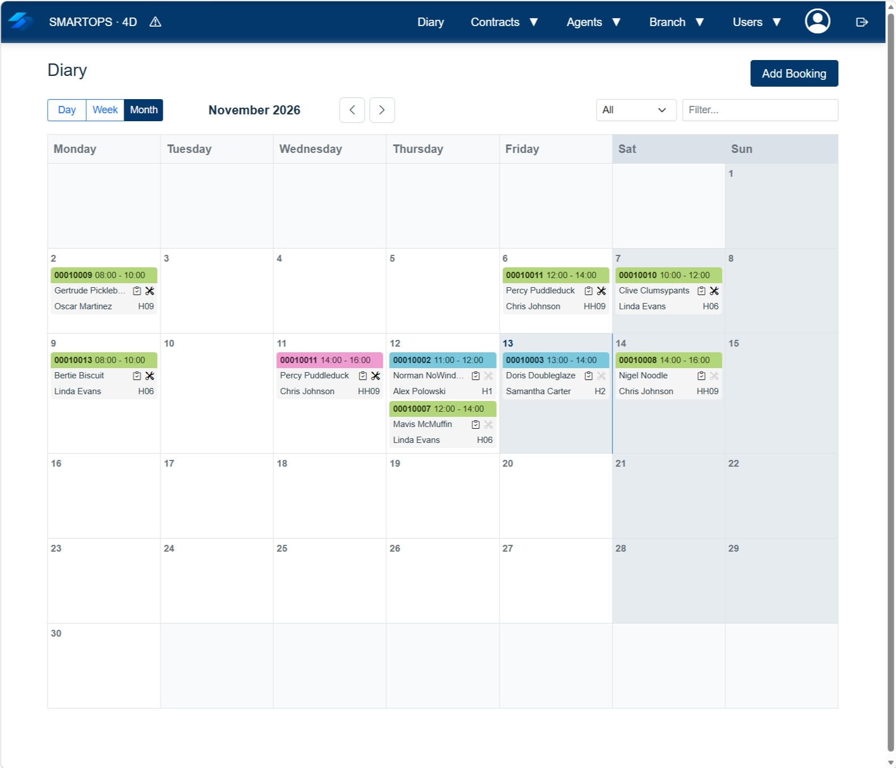
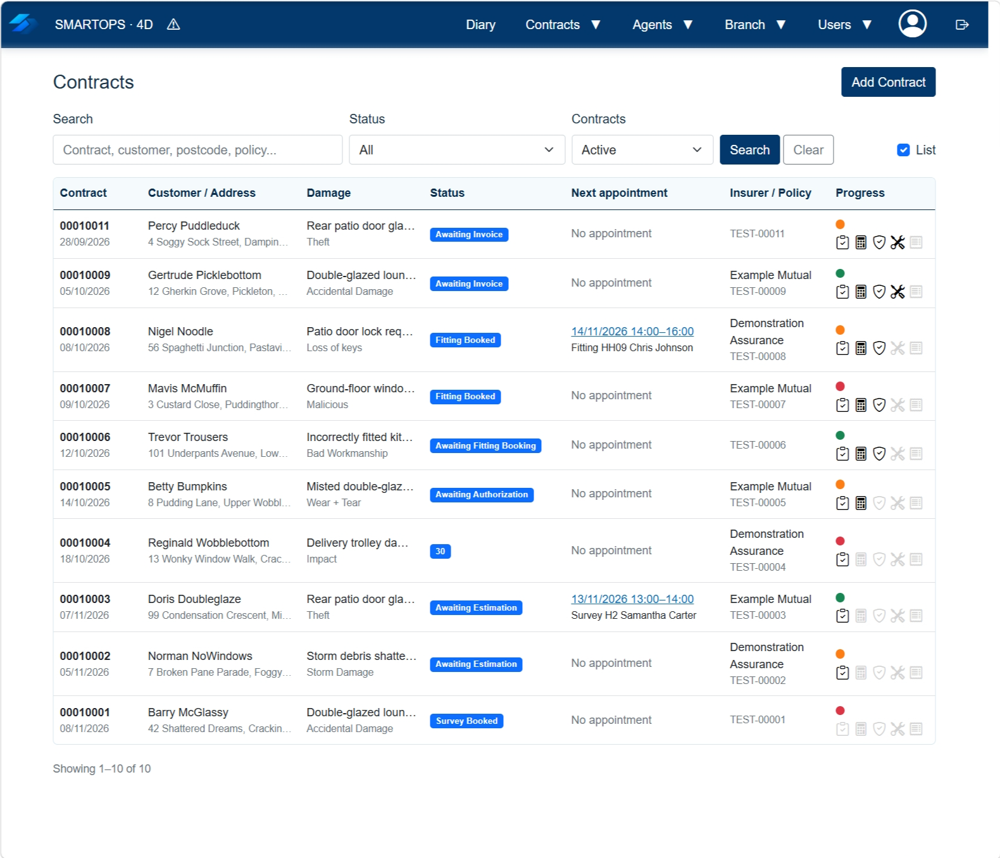
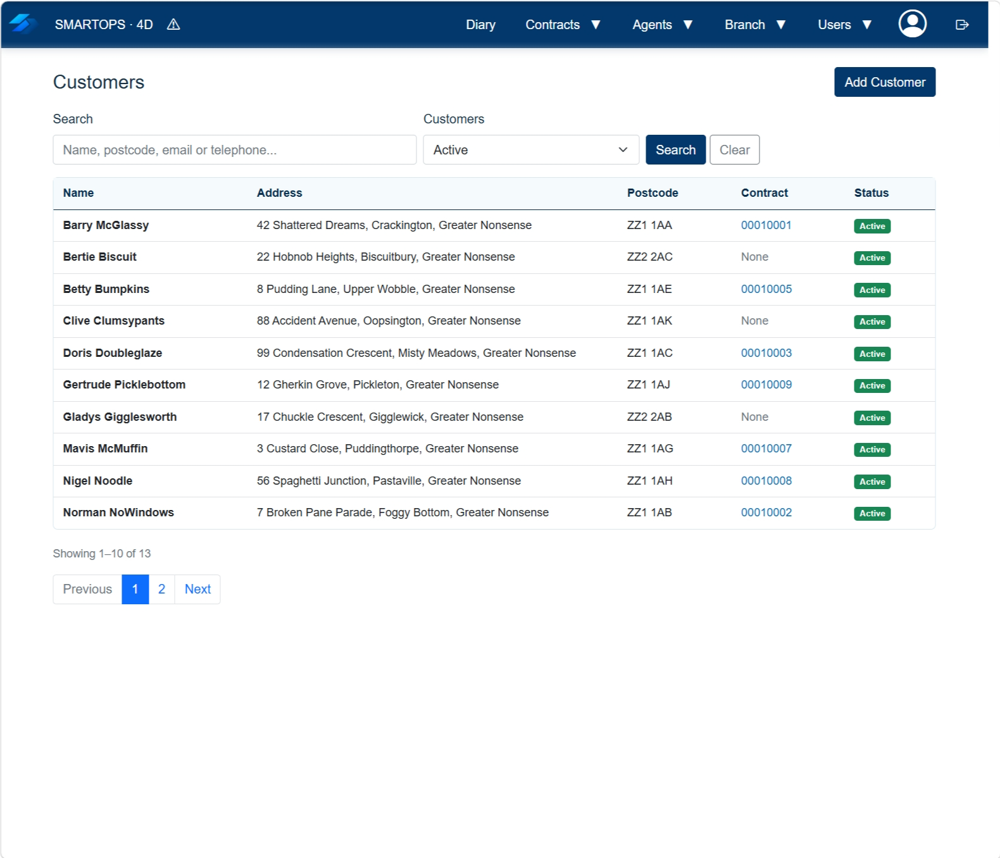
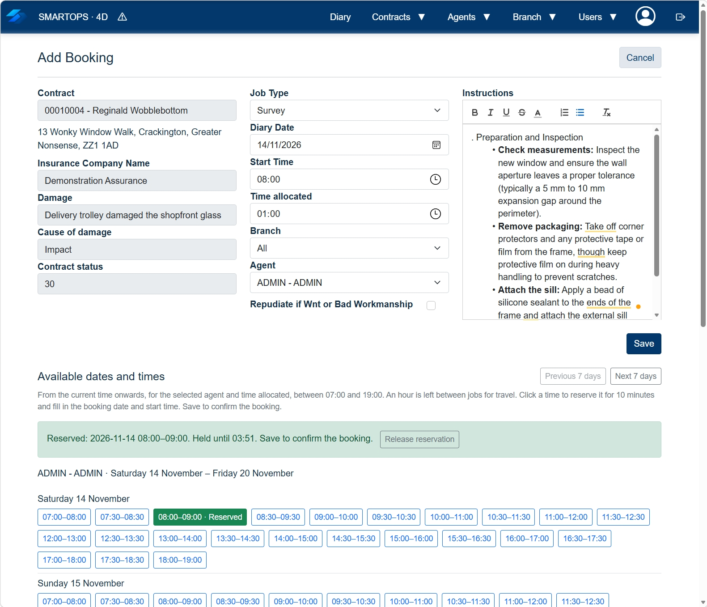
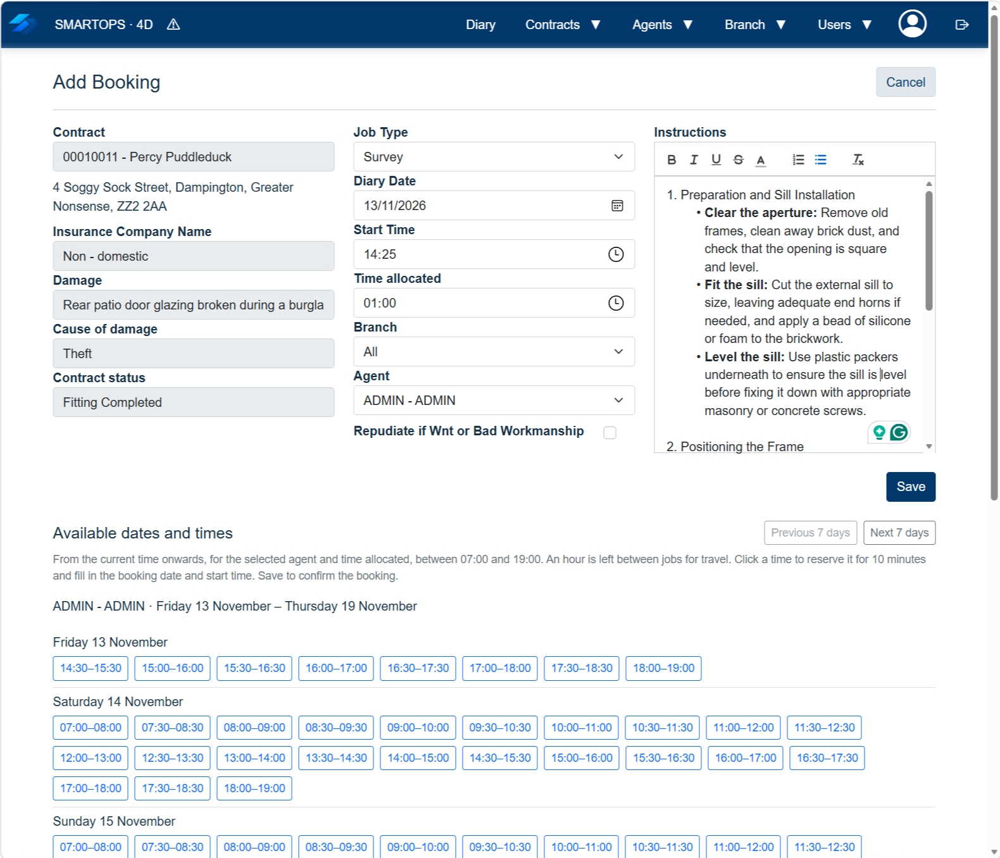

# SmartOps

SmartOps is an **open-source 4D integration and testing platform** for field-service workflows. It combines a native 4D database and HTTP/JSON API with an optional ASP.NET Core web interface. A companion Android survey application is available separately on [Google Play](https://play.google.com/store/apps/details?id=com.authorityx.smartops); its source is not part of this repository.

> **For local development and evaluation only.** The supplied records and accounts are fictional test data. The included credentials, HTTP access and optional serial-number fallback are **not secure production defaults**. 

## Projects

| Project | Purpose |
| --- | --- |
| `SmartOps.4D` | Authoritative 4D database, API server and test-data seeding |
| `SmartOps.4D.Web` | Optional ASP.NET Core MVC frontend and 4D bridge |
| `SmartOps.Shared` | Shared DTOs, integration contracts and question definitions |

**Architecture:** Android survey app → 4D API; optional web frontend → 4D API via a **temporary, per-request SQLite workspace**. SQLite is not a second source of business data.

## Download the Integration Kit

**[Download SmartOps Integration Kit (Windows x64 ZIP)](https://github.com/craiggriffiths2007/SmartOps/releases/latest/download/SmartOps-Integration-Windows-x64.zip)** · [All releases](https://github.com/craiggriffiths2007/SmartOps/releases)

The current kit contains:

- `SmartOps.4D/` — editable 4D source, API and test data
- `SmartOps-Web-Windows-x64.zip` — optional prebuilt, self-contained Windows web frontend
- `README-START-HERE.txt` — release setup instructions
- `APP_API_INTEGRATION.pdf` and `WEB_API_INTEGRATION.pdf` — printable API guides

The PDFs are also available as [Android Survey API PDF](https://github.com/craiggriffiths2007/SmartOps/releases/latest/download/APP_API_INTEGRATION.pdf) and [ASP.NET Web API PDF](https://github.com/craiggriffiths2007/SmartOps/releases/latest/download/WEB_API_INTEGRATION.pdf).

The web frontend is packaged as an **inner ZIP** in the main download. A compatible 4D installation/licence is still required; the prebuilt Windows web frontend does not require Visual Studio or a separate .NET runtime installation. As with any downloaded executable, verify the package and observe normal Windows security warnings.

## Get started

### 1. Start 4D (required)

1. Extract the Integration Kit (or clone the repository).
2. In 4D, open `SmartOps.4D/Project/smartops4d.4DProject`.
3. Create a **new empty data file** if prompted.
4. The 4D `onStartup` method calls `GO_StartLAN`, starts the HTTP API on **port 8045**, and seeds the fictional data **only if the database is completely empty**. `GO_Start` is also available as a manual alias.
5. Test `http://YOUR-PC-IP:8045/api/health` (or localhost if supported by your 4D listener).

Opening a database that already contains records will **not** reset it. To start over, create a separate empty 4D data file; do not delete records you need.

### 2. Run the optional web interface

For the packaged version, extract the inner `SmartOps-Web-Windows-x64.zip` into a folder of its own, then run `SmartOps.Web.exe` while 4D is running. It opens the login page at `http://127.0.0.1:5245/Account/Login` in your default browser. Keep the server console open.

For source development, open `SmartOps.4D.Web` in Visual Studio with the appropriate .NET 11 SDK and run it there. The bridge normally discovers the computer's local Ethernet/Wi-Fi IPv4 address; if it chooses the wrong interface, override the connection using `FourD__BaseUrl=http://YOUR-PC-IP:8045/`.

**Local test login:**

| Field | Value |
| --- | --- |
| Company code | `SMARTOPS` (automatically configured) |
| Username | `admin` |
| Password | `Password1!` |

These are public **testing credentials**. Never reuse them for a production system.

The optional web interface is **an authenticated operational workspace**, not a public marketing website. The Home, News and Insurer Portal pages have been removed; visiting the web root redirects to login (or to the diary when already signed in). Insurer company records remain available to contracts and demonstrations, but insurer portal sign-in is not supported.

### 3. Connect the Android survey app (optional)

Install the [SmartOps Android survey app](https://play.google.com/store/apps/details?id=com.authorityx.smartops). Configure **Server** as `http://YOUR-PC-IP:8045`, company code `SMARTOPS` and an existing agent code such as `ADMIN`.

A blank agent Serial Number in 4D permits login without device-ID registration for local integration testing. When a serial number is registered, the device checks apply; privileged agents require their own registered device. This fallback is **not production-grade authentication**.

On Windows, allow incoming TCP port **8045** on the trusted **Private** network only.

## Included test dataset

The initial seed contains **13 fictional customers and contracts**, three branches, eight agents, 20 vehicles and **18 diary bookings**, plus estimates, insurer records, contract updates, test accounts and a second tenant to exercise isolation. It is based on the smaller GlassOps registration demo dataset rather than the six-month reporting dataset.

## Developer documentation

- [Android Survey API](SmartOps.4D/Documentation/APP_API_INTEGRATION.md) — direct mobile-to-4D integration
- [ASP.NET Web API and bridge](SmartOps.4D/Documentation/WEB_API_INTEGRATION.md) — login, snapshot/commit and web-specific integration
- [4D database schema and ER diagram](SmartOps.4D/Documentation/SCHEMA.md) — native tables and relationships
- [Live GlassOps demonstration](https://glassops.co.uk/) — explore the workflows before testing the 4D integration locally

### Development checks

With the .NET 11 SDK installed, run:

```powershell
dotnet restore SmartOps.4D.Web/SmartOps.4D.Web.csproj
dotnet build SmartOps.4D.Web/SmartOps.4D.Web.csproj --no-restore
```

To validate integration, start 4D and exercise login, diary listing, opening a contract, editing a **test** record and restarting the web frontend to confirm the change is retained in 4D. Check the mobile app independently against the same 4D API. These steps are recommended checks, not an automated test suite.

---

## Screenshots

The following screenshots show the SmartOps interface and example field-service workflows.










